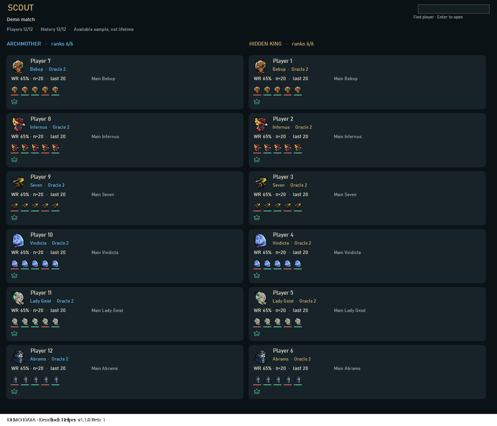
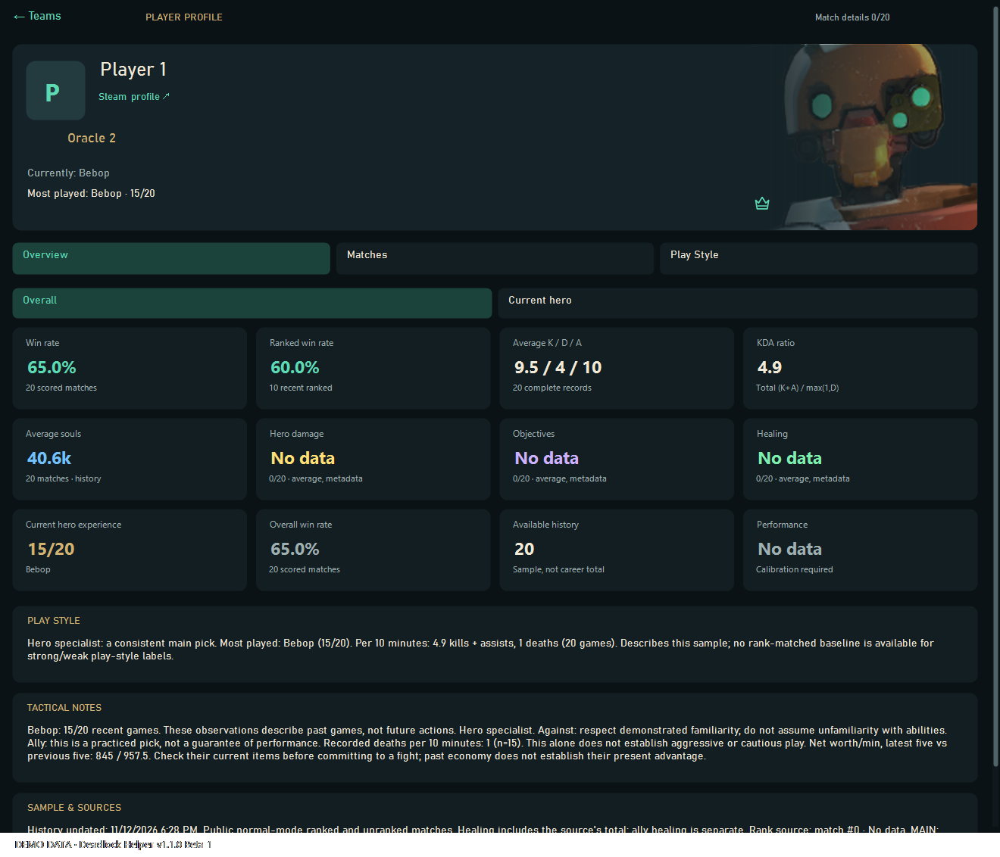
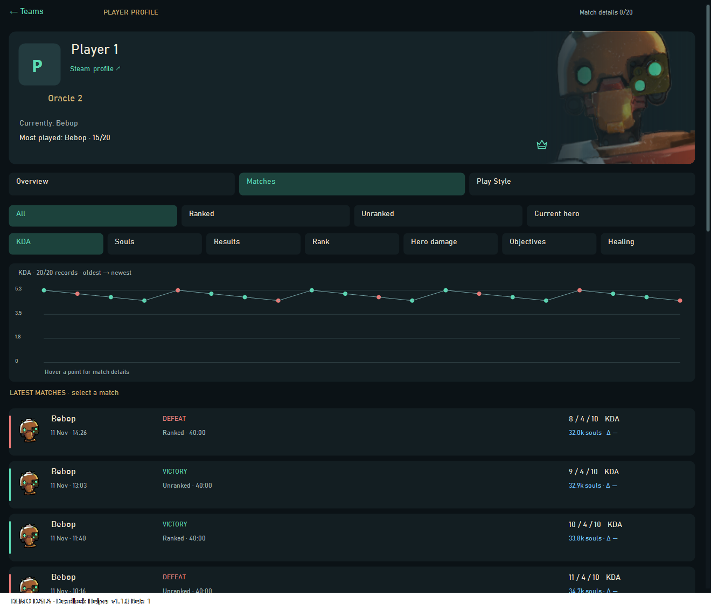
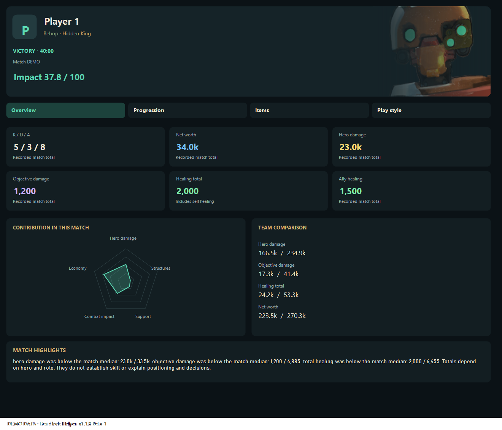
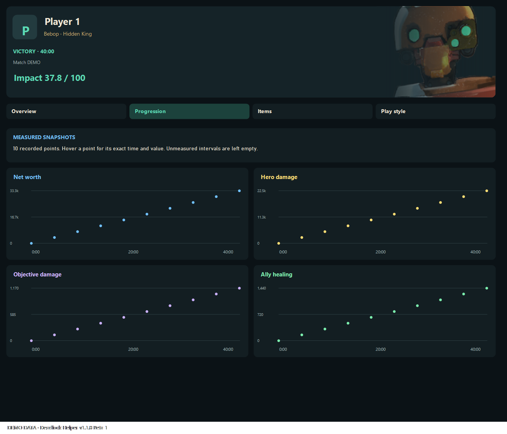
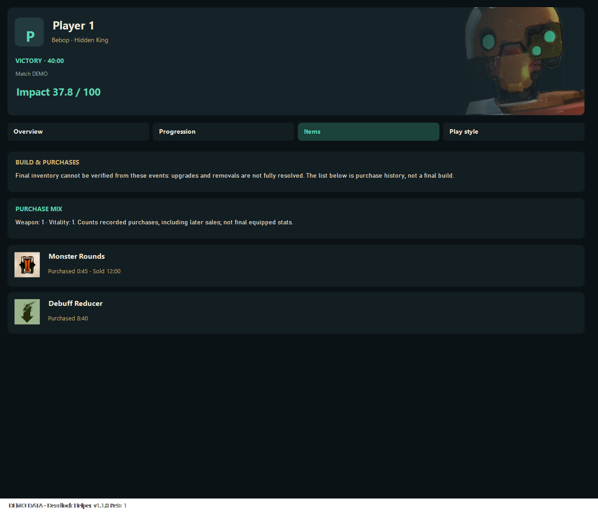



  
  
A focused companion for Deadlock: live statistics, player profiles and match review.

  
<a href="https://github.com/Alexkvintin/deadlock-helper/releases/tag/v1.1.0-beta.1"><strong>Download v1.1.0 Beta 1</strong></a> · <a href="#getting-started">Getting started</a> · <a href="#feedback--ideas">Feedback & ideas</a>

## During your match

- Hero damage, structure damage, healing and unspent souls in separate team panels.
- Automatic local match detection and manual match-ID connection for available broadcasts.
- Counter-item suggestions and individual map timers when source data is available.
- Move and resize panels, adjust opacity, and assign independent visibility shortcuts.
- English and Russian interfaces, with display scaling and multiple-monitor support.

## Scout and player profiles

- Two-team roster, available ranks, recent results and current-hero experience.
- Independent explained tags, including current-hero MAIN and recent win streaks.
- Player profiles with public avatars, hero artwork, match history and charts.
- Overall / Current hero views and ranked, unranked and hero history filters.
- Cautious tactical notes based on recorded current-hero statistics.
- Suggested party groups with consistent letters, colors and dashed outlines. These are historical inferences, not confirmed current parties.

## Match review

- Result and duration when known, player statistics, comparative Impact Score, radar and team totals.
- Recorded economy, damage, objectives and ally-healing snapshots, with exact point tooltips.
- Item icons, purchase chronology and recorded sale times.
- Contribution highlights and limited comparisons with suitable earlier cached games.

Progression and item history

*Screens are rendered by the application's own controls using fictional players and demonstration statistics. They are not live-match captures or item recommendations. Artwork belongs to its respective owners.*

## Beta limitations

- Match history, avatars and detailed reports depend on public data availability. Private/bot games may have no public record.
- Party groups are inferred. LOW/HIGH skill ratings are not enabled.
- Sparse graphs show recorded snapshots only. Purchase history is not presented as a verified final inventory.
- Some tactical conclusions and historical comparisons remain unavailable with small or incomplete samples.
- Game portraits, item icons and profile artwork are retrieved into the local cache when available; a first online load may show placeholders. The ZIP does not bundle game artwork without verified redistribution permission.

## Getting started

1. Download **DeadlockHelper-v1.1.0-beta.1-win-x64.zip** from [this release](https://github.com/Alexkvintin/deadlock-helper/releases/tag/v1.1.0-beta.1).
2. Extract the entire archive into one folder.
3. Run **DeadlockHelper.exe**.
4. Launch Deadlock and configure **Overlay**, **Scout** and **Hotkeys**.

Windows 10/11 x64 with .NET Framework 4.8. **Do not move the EXE separately from the other files.** If an OCR component cannot load, install the [Microsoft Visual C++ x64 runtime](https://learn.microsoft.com/en-us/cpp/windows/latest-supported-vc-redist).

Closing the settings window keeps the app in the notification area. Use **About → Exit** to quit. Existing settings are retained.

## Feedback & ideas

Feedback is entirely optional. English and Russian are welcome.

| Share | Link |
| --- | --- |
| A review of your experience | [Leave a review](https://github.com/Alexkvintin/deadlock-helper/issues/new?template=review.yml) |
| An improvement you would like | [Suggest an idea](https://github.com/Alexkvintin/deadlock-helper/issues/new?template=idea.yml) |
| Something that does not work | [Report an issue](https://github.com/Alexkvintin/deadlock-helper/issues/new?template=bug.yml) |

These forms also open from the app's **About** page. Nothing is submitted automatically. The repository is public; a GitHub account is needed to submit a form.

## Notes

Public broadcasts depend on upstream availability and request limits. Some map-event timings and lane changes are unavailable in certain match contexts; an unknown value is not presented as confirmed data. Impact scores compare contribution within one match, not global player skill.

[Usage guide](docs/HELP.md) · [Privacy](docs/PRIVACY.md) · [Credits](docs/CREDITS.md) · [Publication review](https://github.com/Alexkvintin/deadlock-helper/blob/main/docs/SECURITY-REVIEW.md)

## Build

Run `build.ps1` on Windows with .NET Framework 4.8 to compile the desktop application. Build the local reader with `scripts/build-local-reader.ps1`; this requires Rust and a Windows C++ toolchain. The reader dependency is pinned in `native-reader/Cargo.lock`. `scripts/package.ps1` creates the portable release.

## License and author

**Deadlock Helper by kvintin** uses the [Deadlock Helper Personal Use License 1.1](LICENSE), a source-available license, not an open-source license.

- **Allowed for free:** download, use, study, compile and privately modify the code for your own noncommercial purposes.
- **Written permission required:** publish or redistribute original or modified code/builds; sell the app, offer subscriptions or premium features, or monetize it through in-app advertising, sponsorships, revenue-generating referral links or other revenue sources, even if downloads are free.
- **Credit is mandatory for authorized modifications:** name kvintin as the original author, link the original project, and include “Based on Deadlock Helper, originally created by kvintin.” Modification authors may credit their own additions only. Attribution does not replace permission.
- **Reviews and streams are welcome**, including monetized YouTube videos, provided they do not distribute software/source code or misrepresent authorship.

[Request written permission](https://github.com/Alexkvintin/deadlock-helper/issues/new?template=permission.yml). Earlier grants, statutory rights and rights under GitHub's applicable terms are preserved by section 6. Third-party components retain their own licenses; kvintin's permission does not grant rights to Valve artwork or other third-party materials. See [credits](docs/CREDITS.md) and the [licensing review](docs/LICENSE-REVIEW.md). The full LICENSE controls over this summary.
