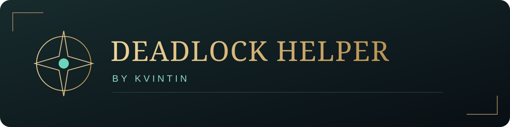
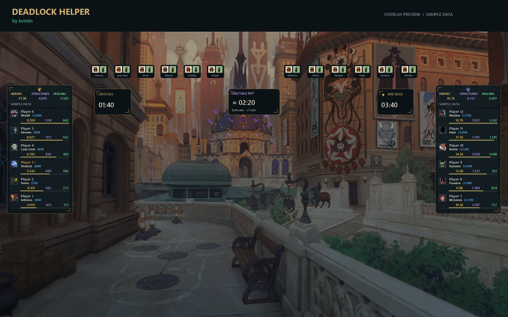
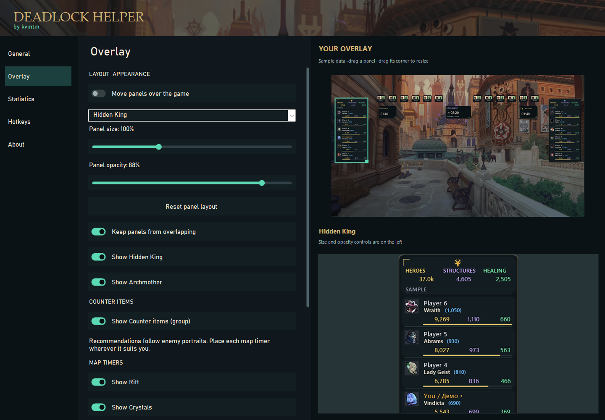

  
  
A focused companion for your Deadlock matches.

  
<a href="https://github.com/Alexkvintin/deadlock-helper/releases/latest"><strong>Download v1.0.1</strong></a> · <a href="#getting-started">Getting started</a> · <a href="#feedback--ideas">Feedback & ideas</a>

## A look inside

*Rendered by the application's own panels with fictional players and sample statistics. Item pictures illustrate placement, not a build recommendation. The background is artwork, not a live match capture.*

Customize your layout in the Overlay menu

*The actual settings interface rendered in offline demo mode. No real player accounts or private settings appear here.*

## During your match

- Hero damage, structure damage, healing and unspent souls in clear team panels.
- Automatic local match detection, with manual match-ID connection for available broadcasts.
- Counter-item suggestions for your hero and the opponent roster.
- Individual map timers and a post-match report when completion data is available.
- Move and resize panels, adjust opacity and assign independent visibility shortcuts.
- English and Russian interfaces with layouts that adapt to your display.

## Getting started

1. Download **DeadlockHelper-v1.0.1-win-x64.zip** from [Releases](https://github.com/Alexkvintin/deadlock-helper/releases/latest).
2. Extract the entire archive into a folder.
3. Run **DeadlockHelper.exe**, then open a match in Deadlock.
4. Configure panels in **Overlay** and shortcuts in **Hotkeys**.

Windows 10/11, 64-bit, with .NET Framework 4.8. Keep the included files next to the executable. If an OCR component cannot load, install the [Microsoft Visual C++ x64 runtime](https://learn.microsoft.com/en-us/cpp/windows/latest-supported-vc-redist).

Closing the settings window keeps the application in the notification area. Use **About → Exit** to quit. Existing settings from earlier test builds are retained.

## Feedback & ideas

Feedback is entirely optional. English and Russian are welcome.

| Share | Link |
| --- | --- |
| A review of your experience | [Leave a review](https://github.com/Alexkvintin/deadlock-helper/issues/new?template=review.yml) |
| An improvement you would like | [Suggest an idea](https://github.com/Alexkvintin/deadlock-helper/issues/new?template=idea.yml) |
| Something that does not work | [Report an issue](https://github.com/Alexkvintin/deadlock-helper/issues/new?template=bug.yml) |

These forms also open from the app's **About** page. Nothing is submitted automatically. The repository is public; a GitHub account is needed to submit a form.

## Notes

Public broadcasts depend on upstream availability and request limits. Some map-event timings and lane changes are unavailable in certain match contexts; an unknown value is not presented as confirmed data. Impact scores are comparative estimates, not a complete measure of a player's performance.

[Usage guide](docs/HELP.md) · [Privacy](docs/PRIVACY.md) · [Credits](docs/CREDITS.md) · [Publication review](https://github.com/Alexkvintin/deadlock-helper/blob/main/docs/SECURITY-REVIEW.md)

## Build

Run `build.ps1` on Windows with .NET Framework 4.8 to compile the desktop application. Build the local reader with `scripts/build-local-reader.ps1`; this requires Rust and a Windows C++ toolchain. The reader dependency is pinned in `native-reader/Cargo.lock`. `scripts/package.ps1` creates the portable release.

## License and author

**Deadlock Helper by kvintin** is source-available for inspection, with personal noncommercial use permitted under the [Deadlock Helper Personal Use License](LICENSE). Selling, modifying, republishing or redistributing covered material requires **prior written permission from kvintin**. Adding a line or changing a name does not transfer authorship. Screenshots, reviews and gameplay videos are welcome under the license.

[Request permission](https://github.com/Alexkvintin/deadlock-helper/issues/new?template=permission.yml). Earlier license grants, third-party rights and mandatory legal exceptions are preserved by section 6. Game artwork and dependencies retain their own notices; this project is not affiliated with Valve.
